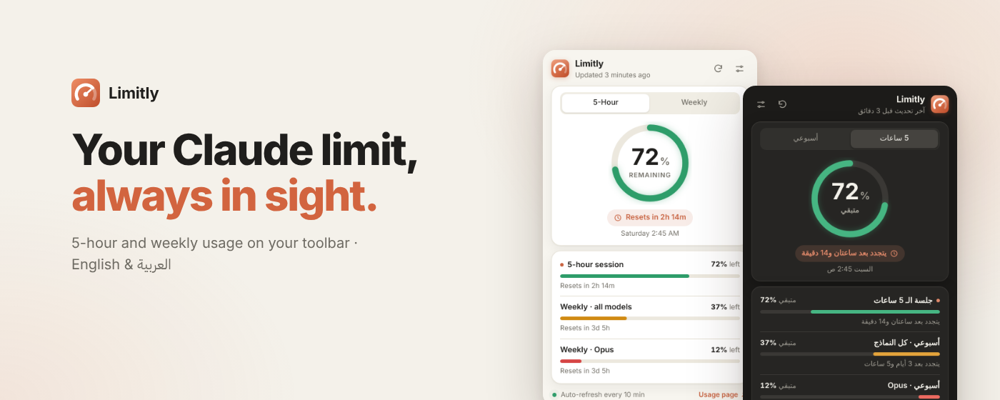
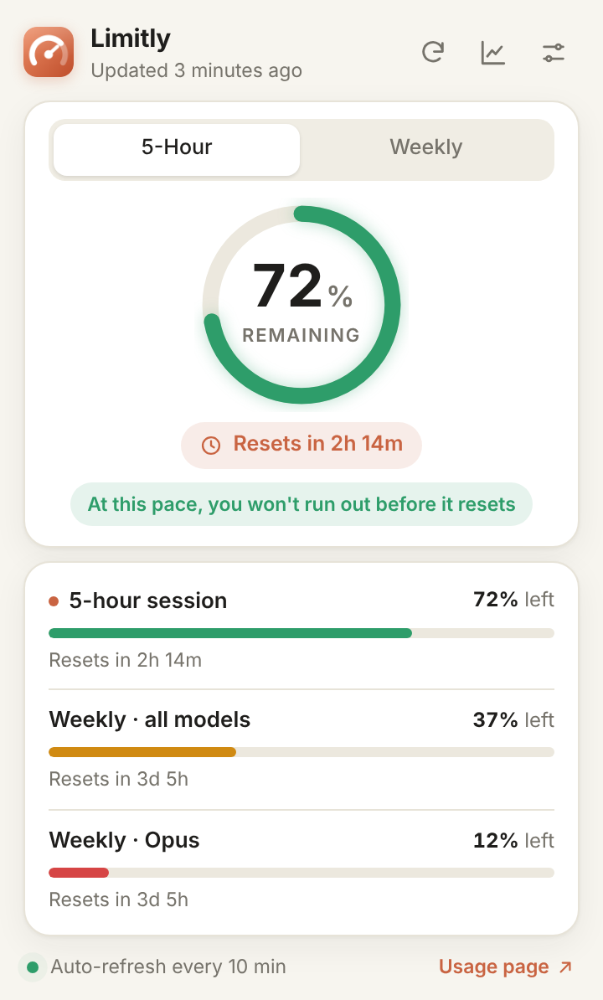
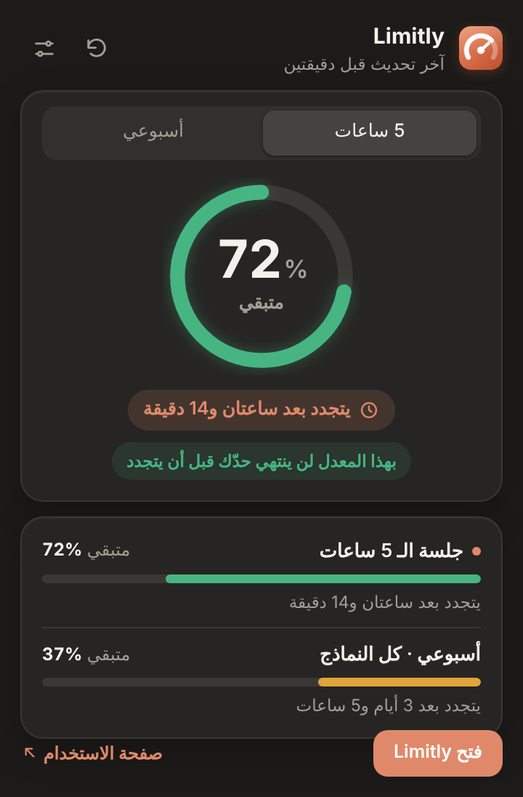
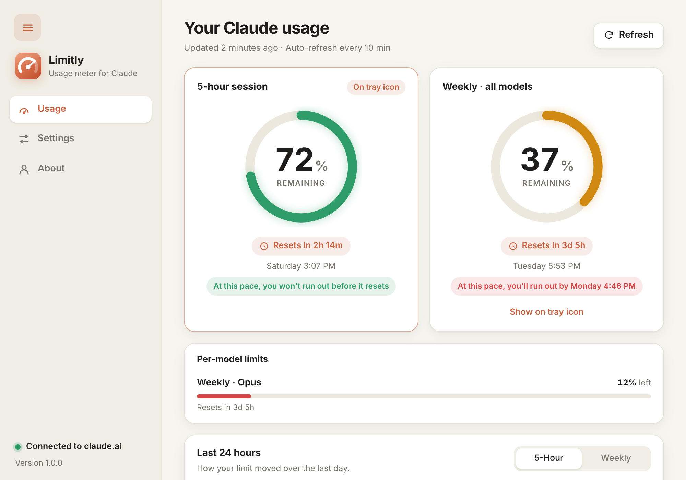

  

<h1 align="center">Limitly</h1>

  <b>Your Claude limit, always in sight.</b> 
  A Chrome extension and a Windows app that show how much of your 5-hour and weekly Claude usage is left.

  
  
  
  

  <a href="https://loailoubani.github.io/Limitly/"><b>Download page</b></a> ·
  <a href="https://github.com/loailoubani/Limitly/releases/latest">Latest release</a> ·
  <a href="https://loailoubani.github.io/Limitly/privacy.html">Privacy</a>

  

## Download

| Platform | Get it |
|---|---|
| **Windows 10 / 11** | [**Limitly-Setup.exe**](https://github.com/loailoubani/Limitly/releases/latest/download/Limitly-Setup.exe) · Microsoft Store coming soon |
| **Chrome** | [**Limitly-Chrome.zip**](https://github.com/loailoubani/Limitly/releases/latest/download/Limitly-Chrome.zip) · Chrome Web Store coming soon |

Step-by-step install instructions are on the [download page](https://loailoubani.github.io/Limitly/#download).

## Features

- **5-hour and weekly limits** side by side, with per-model limits and exact reset times.
- **Always on screen:** a colour-coded percentage on the Chrome toolbar and the Windows taskbar.
- **Alerts** when 20%, and then 5%, of a limit is left.
- **Pace:** "At this pace, you'll run out by 3:40."
- **24-hour history** chart.
- **Gentle on claude.ai:** checks every 10 minutes by default and waits when asked to slow down.
- **Arabic and English**, light and dark.
- **Free, no ads, no tracking.** Everything stays on your device.

<table>
  <tr>
    <td width="26%"></td>
    <td width="26%"></td>
    <td></td>
  </tr>
  <tr>
    <td align="center">Chrome popup</td>
    <td align="center">Taskbar flyout</td>
    <td align="center">Windows app</td>
  </tr>
</table>

## Author

Designed and developed with the help of AI by **Loai Housam Loubani**, Software QA Specialist (manual and
automation) · [LinkedIn](https://www.linkedin.com/in/loai-loubani-925aba2ba)

### بالعربي

**Limitly** إضافة لـ Chrome وتطبيق لـ Windows يعرضان ما تبقّى من حدّ استخدامك في Claude على شريط الأدوات وشريط
المهام، مع تنبيهات قبل أن ينتهي الحد، وتوقّع لوقت انتهائه، وسجل آخر 24 ساعة. مجاني، بلا إعلانات، وكل البيانات تبقى
على جهازك. التحميل من [صفحة التحميل](https://loailoubani.github.io/Limitly/?lang=ar).

---

This repository hosts Limitly's download page and releases. Limitly is an independent project and is not
affiliated with, endorsed by, or sponsored by Anthropic.
